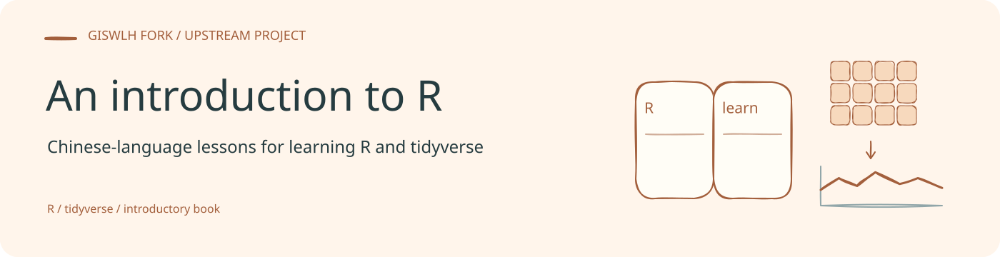
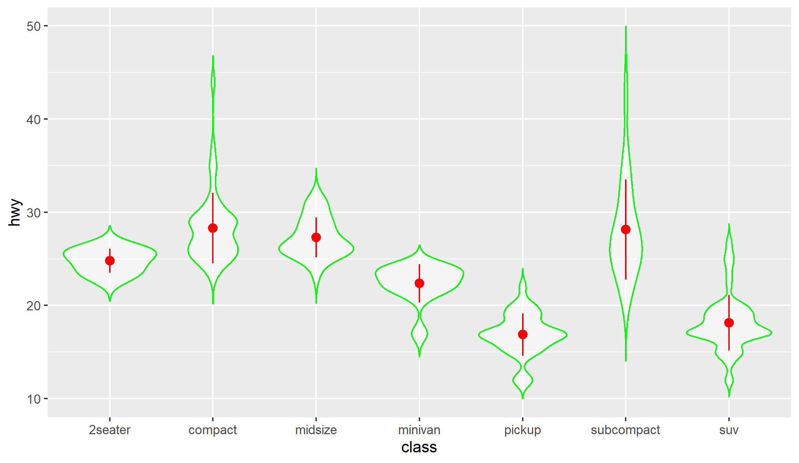

<!-- readme-visual-refresh:banner -->

<!-- /readme-visual-refresh:banner -->

# introR

《R语言编程：基于tidyverse》已正式上线！可到京东、天猫、当当等平台搜索【R语言编程】购买！

《R语言编程：基于tidyverse》是一本中文 R 语言编程入门书，也是为 R 语言正名之书，基于最新 tidyverse 包，讲解真正的编程思维和数据思维：

欢迎加入本书的 [知乎交流平台](https://zhuanlan.zhihu.com/p/198185888)，读者交流、答疑 QQ 群 (222427909，1群已满)、微信公众号：

<!-- readme-visual-refresh:artwork-source -->
[Editable banner artwork · Excalidraw](assets/readme/banner.excalidraw)
<!-- /readme-visual-refresh:artwork-source -->

<!-- readme-visual-refresh:selected-result -->

## 已有结果展示

原 R 教材图 3.25：按车辆类别绘制 highway 指标的小提琴图，并标注均值和标准差。 该图为仓库已有上游示例，保留原有来源；本次仅整理展示，未重新运行。 [查看来源](https://github.com/GISWLH/introR_ZhangJX_Rbook/blob/master/images/%E5%9B%BE3.25%20%E6%A0%87%E6%B3%A8%E5%9D%87%E5%80%BC%E5%92%8C%E6%A0%87%E5%87%86%E5%B7%AE%E7%9A%84%E5%B0%8F%E6%8F%90%E7%90%B4%E5%9B%BE.png)。

<!-- /readme-visual-refresh:selected-result -->
